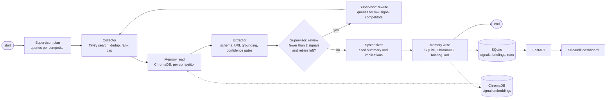

# CompeteIQ

[](https://github.com/thi-28/CompeteIQ/actions/workflows/ci.yml)

A multi-agent competitive-intelligence pipeline built with LangGraph. Each week it searches the
web for news about a set of AI companies, extracts structured signals that are grounded in a
real source URL, and writes a markdown briefing. It keeps what it learned in SQLite and ChromaDB,
so each run knows what earlier runs already reported.

It serves the results through a FastAPI service and a Streamlit dashboard.

**Key ideas**

- **Source grounding.** Every stored signal cites a URL that was actually collected in that run.
  The extractor drops any signal whose `source_url` isn't among the snippets it was given, and
  the synthesizer keeps only briefing bullets whose `[n]` citations point at real signals.
- **A supervisor that makes a real decision.** After extraction it counts signals per
  competitor. Any competitor with fewer than `MIN_SIGNALS_PER_COMPETITOR` (2) gets rewritten
  queries, based on why the first ones failed, and only that competitor is searched and
  extracted again. Each competitor gets at most `MAX_RESEARCH_RETRIES` (2) retries, tracked in
  graph state.
- **Memory across runs.** Past signals are retrieved **per competitor** with a ChromaDB `where`
  filter, and near-duplicates are skipped when stored. The weekly GitHub Action restores and
  saves `data/`, so memory persists between scheduled runs.

## Architecture



| Component | File | Role |
|---|---|---|
| Supervisor | `agents/supervisor.py` | Plans queries, reviews signal counts, rewrites queries for low-signal competitors |
| Collector | `agents/collector.py` | Tavily search with retry and backoff; removes duplicate URLs, ranks by score, caps snippets per competitor |
| Extractor | `agents/extractor.py` | LLM extraction, then three gates: schema, source-URL grounding, confidence threshold |
| Synthesizer | `agents/synthesizer.py` | Executive summary and implications; drops any bullet with an invalid citation |
| Semantic memory | `memory/semantic.py` | SQLite (SQLAlchemy 2.0): idempotent signal saves, briefings, run history |
| Episodic memory | `memory/episodic.py` | ChromaDB: per-competitor retrieval, deterministic IDs, similarity dedup |
| Graph | `main.py` | LangGraph wiring, `run_pipeline()`, CLI |
| API | `api/main.py` | FastAPI: start runs, read briefings, signals, run history and health |
| Dashboard | `dashboard/app.py` | Streamlit, reading data only through the API |

## Quick start

### Local

```bash
python3.11 -m venv .venv && source .venv/bin/activate
pip install -r requirements-dev.txt
cp .env.example .env          # set OPENAI_API_KEY and TAVILY_API_KEY

python main.py                                  # one run over DEFAULT_COMPETITORS
python main.py --competitors "Anthropic,Mistral"

uvicorn api.main:app --reload                   # API on http://localhost:8000 (docs at /docs)
streamlit run dashboard/app.py                  # dashboard on http://localhost:8501
```

A run writes to `data/`: `competeiq.db` (SQLite), `chroma/` (vectors), and
`briefings/<run_id>.md`. The CLI prints the run summary as JSON. It exits with 1 if the run
crashed, or if search returned nothing for any competitor (for example, bad keys or no quota).

### Docker

```bash
cp .env.example .env
docker compose up --build                       # API on :8000, dashboard on :8501
docker compose run --rm api python main.py      # one pipeline run into the shared volume
```

Both services run from one image. Only the `api` service mounts the `competeiq-data` volume
and receives the provider keys. The dashboard reaches the API at `http://api:8000`.

### Tests

```bash
pytest --cov
```

The tests use fakes for OpenAI and Tavily, so they need no keys. The graph tests run the real
compiled LangGraph against real SQLite and ChromaDB in a temp directory. The coverage
threshold is set in `.coveragerc`.

## Configuration

All settings come from environment variables (see `.env.example`). The defaults live in
`config.py`, and a test checks that `.env.example` matches them.

| Setting | Default | Purpose |
|---|---|---|
| `OPENAI_API_KEY`, `TAVILY_API_KEY` | (required) | LLM and search providers |
| `OPENAI_MODEL` | `gpt-4o-mini` | Supervisor, extractor and synthesizer model |
| `EMBEDDING_MODEL` | `text-embedding-3-small` | Signal embeddings for ChromaDB |
| `DEFAULT_COMPETITORS` | `Anthropic,Google,Meta,Mistral,Perplexity` | Used when no list is given |
| `MAX_SNIPPETS_PER_COMPETITOR` | `10` | Cap on snippets sent to the extractor per competitor |
| `CONFIDENCE_THRESHOLD` | `0.6` | Minimum confidence for a signal to be kept |
| `MIN_SIGNALS_PER_COMPETITOR` | `2` | Below this, the supervisor re-searches |
| `MAX_RESEARCH_RETRIES` | `2` | Re-search limit per competitor per run |
| `DEDUP_SIMILARITY_THRESHOLD` | `0.92` | Cosine similarity at which a new signal counts as a duplicate |
| `MEMORY_TOP_K` | `5` | Past signals retrieved per competitor |
| `DATA_DIR`, `SQLITE_DB_PATH`, `CHROMA_PERSIST_DIR` | `./data/...` | Storage locations |
| `API_KEY` | (unset) | If set, `POST /run` requires a matching `X-API-Key` header |
| `API_BASE_URL` | `http://localhost:8000` | Where the dashboard finds the API |
| `LOG_LEVEL` | `INFO` | Logging level |

## API

Interactive docs are served at `/docs` once the API is running.

| Method | Path | Description |
|---|---|---|
| `POST` | `/run` | Start a run in the background. Optional body `{"competitors": [...]}`. Returns `202` with the `run_id`. Returns `409` if a run is already active, and `401` if `API_KEY` is set and the header is missing or wrong |
| `GET` | `/runs` | Run history, newest first (`limit` ≤ 500, `offset`) |
| `GET` | `/runs/{run_id}` | One run. `status` is `running`, `succeeded` or `failed`; also signal and error counts and re-searches per competitor |
| `GET` | `/briefings` | Briefing list without content (`limit` ≤ 200, `offset`) |
| `GET` | `/briefings/latest` | Most recent briefing with its markdown |
| `GET` | `/briefings/{run_id}` | Briefing for a run |
| `GET` | `/signals` | Filters: `competitor` (case-insensitive), `signal_type`, `run_id`, `since` (ISO 8601 with timezone), `limit` ≤ 1000, `offset` |
| `GET` | `/health` | Database check, configured models, whether keys are set (true/false only), active run |

## Dashboard

There are four tabs:

- **Briefings:** pick a run, read the briefing, download it.
- **Signal explorer:** filter by competitor, type, impact and confidence, with source links.
- **Trends:** signals per week by competitor, and signal types.
- **Run history:** past runs, with a "Start run" panel.

Each competitor keeps the same color in every chart, and every chart has a table view.

## Evaluation

`python evals/run_eval.py --judge` scores the production extractor (same prompt and gates) on
20 hand-labeled **synthetic** snippets about fictional companies: 15 gold signals and 6
snippets that should yield nothing (rumor, opinion, off-topic, listicle, job post). The
dataset and metric definitions are in [evals/README.md](evals/README.md).

Results: _placeholder, not yet run. Fill in from the script's output._

| Metric | Value |
|---|---|
| Extraction precision (strict) | _TBD_ |
| Extraction recall (strict) | _TBD_ |
| F1 (strict) | _TBD_ |
| Precision / recall (type-agnostic) | _TBD_ |
| Negative rejection (rumor, opinion, off-topic) | _TBD_ |
| URL grounding before guard | _TBD_ |
| Faithfulness (LLM judge) | _TBD_ |

## Sample output

_Placeholder: this section will show an excerpt of a real briefing from a real run, copied
from `data/briefings/<run_id>.md`, together with the run's date and model. No example is shown
until then, so nothing here is invented._

A briefing has these sections:

- `# CompeteIQ Briefing: <date>`
- `## Executive Summary`
- `## Key Developments`, with one `### <competitor>` block per competitor. Each development has
  its type, impact, confidence and a `[source](url)` link.
- `## Strategic Implications`, with `[n]` citations to the developments.
- `## Signals to Watch`

## GitHub Actions

- **`ci.yml`:** runs on every push and PR. It runs pytest with coverage and builds the Docker
  image. It needs no secrets.
- **`weekly.yml`:** runs Mondays 08:00 UTC, or on demand with an optional competitor list.
  1. Restores `data/` from the newest per-run cache. GitHub deletes caches unused for 7 days,
     so if that happened it falls back to the latest `competeiq-data` artifact (kept 90 days).
  2. Runs the pipeline.
  3. Adds the briefing to the job summary, then saves `data/` both ways.

  It never saves unless memory was restored first. It needs the repository secrets
  `OPENAI_API_KEY` and `TAVILY_API_KEY`.

## Tech stack

| Choice | Why |
|---|---|
| **LangGraph** | The supervisor's re-search loop is a conditional edge with typed state (`retry_counts`, `low_signal_competitors`) and an `operator.add` reducer for errors. A linear chain can't express the loop, and a free-form agent loop can't guarantee the retry limit |
| **OpenAI `gpt-4o-mini`** with JSON mode | Cheap enough for weekly runs over many snippets. JSON mode plus Pydantic validation turns free text into checked `Signal` objects |
| **`text-embedding-3-small`** | Inexpensive, good enough for near-duplicate detection and per-competitor retrieval |
| **Tavily** | A search API built for LLM pipelines. Returns cleaned page content with a URL and score, which grounding needs |
| **SQLite + SQLAlchemy 2.0** | Structured, queryable record (signals, briefings, runs) in one file. A unique constraint with `ON CONFLICT DO NOTHING` makes saves idempotent |
| **ChromaDB** | Embedded vector store with metadata `where` filters (per-competitor retrieval) and nothing to host. It persists to a directory that CI can cache |
| **Pydantic v2** | One schema for LLM output validation, API responses and graph data |
| **FastAPI** | Typed request and response models, automatic OpenAPI docs, background tasks for runs |
| **Streamlit + Plotly** | A data dashboard in a single Python file. Plotly gives hover tooltips and unified hover on time series |
| **Docker Compose** | One image run as two services, with a named volume shared by the API and one-off pipeline runs |
| **GitHub Actions** | CI on every push, plus a scheduled run whose memory survives between runs through cache and artifact |

## Project layout

```
agents/      supervisor, collector, extractor, synthesizer, memory graph nodes
memory/      semantic.py (SQLite), episodic.py (ChromaDB)
tools/       Tavily search client, URL normalization, briefing formatter
models/      Pydantic schemas and LangGraph state
api/         FastAPI app
dashboard/   Streamlit app and pure data transforms
evals/       labeled dataset and extraction eval script
tests/       pytest suite (no network)
main.py      graph wiring, run_pipeline(), CLI
config.py    settings and model defaults (single source of truth)
```
